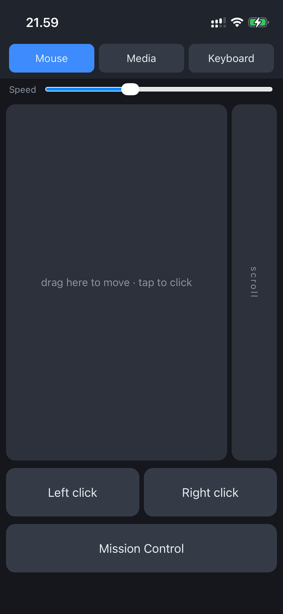
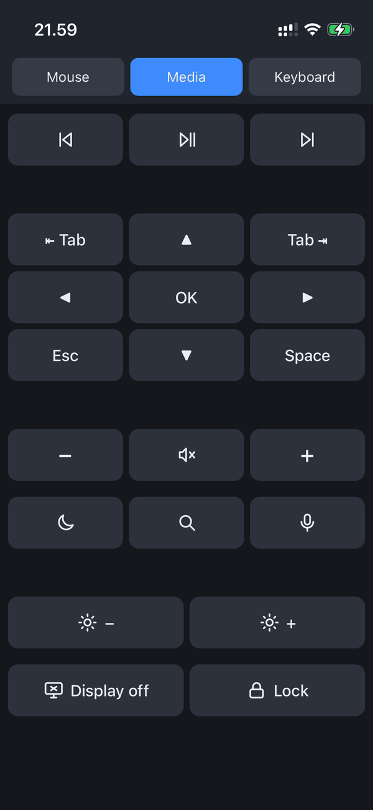
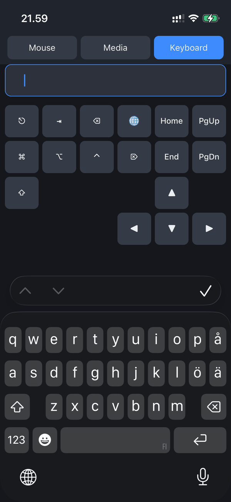

# diy-mac-remote — your iPhone as a **keyboard**, **trackpad** and **media remote** for your Mac, built and delivered by you.

<div align="center">
  <table>
    <tr>
      <td align="center"></td>
      <td align="center"></td>
      <td align="center"></td>
    </tr>
    <tr>
      <td align="center"><b>The trackpad</b></td>
      <td align="center"><b>The media tab</b></td>
      <td align="center"><b>The keyboard</b></td>
    </tr>
  </table>
</div>

Letting something 🕹️ **control your Mac** means 🔐 **trusting whoever built it** —
and trusting that 🕵️ **_they_ haven't been hacked** either. So this project keeps that
list of trusted parties as short as possible: you build and deliver it
**yourself**, from readable sources.

There are two pieces: 💻 a small server that runs on your Mac (the [`app/`](app/)
folder, plain JavaScript with no dependencies at all), and 📱 a web page you open
on your iPhone (`public/index.html`, one self-contained file). No App Store app,
no compiled installer, ever — you get the source for both and decide how to ship
and run them, guided by the recipes here.

The server runs **inside macOS's own `osascript`**, which is how it types and
clicks without a compiler or a native module. Nothing is signed by us, hosted by
us, or phoning home to us — once you've downloaded the repo, there is no "us" in
the loop.

And as a nice side effect: 🎁 no cost, no ads.

🔍 Don't take my word for it either. If you have an LLM agent, first download the
repository and ask your LLM to check the files for anything clever.

## What it does

### The trackpad

The app opens on the **Mouse** tab. It's a remote trackpad:

- **Drag** anywhere on the trackpad area to move the cursor (relative movement,
  like a laptop trackpad); **tap** it for a left click.
- A **scroll** strip down the side scrolls the wheel.
- **Left click** / **Right click** buttons below the pad. They are
  **press-and-hold**: the button stays down while you hold it, so you can hold a
  button and drag on the trackpad with another finger to drag-and-drop, then
  release to drop.
- A **Mission Control** button under them opens Mission Control (Esc, or a
  click, closes it). It needs no permission: it's `open -a "Mission Control"`.
- A **sensitivity** slider at the top scales pointer speed (0.5–6×, default 2.5).

Moves and scrolls are coalesced client-side and sent on the same ~50 ms grid as
keystrokes, so a drag becomes a few summed deltas rather than a flood of
messages.

### The media tab

The middle **Media** tab is a TV-remote-style panel, top to bottom:

- **previous / play-pause / next**, which go through macOS's MediaRemote to
  whichever app owns Now Playing (Music, Spotify, a browser tab…).
- **Navigation**: a 3×3 pad of ⇤ Tab (shift-tab), ↑, Tab ⇥, ←, **OK** (return),
  →, Esc, ↓, Space — enough to drive a slideshow, a video player, or a dialog
  from the couch. Modifiers latched on the Keyboard tab don't apply here.
- **Volume** − / mute / + (AppleScript's `set volume`, in steps of 6% —
  no on-screen HUD).
- **Do Not Disturb**, **Spotlight** (⌘Space) and **Dictation**. Do Not Disturb
  and Dictation press the moon and microphone keys of Apple's newer keyboards.
  Tap Dictation to start and stop it, or **hold** it to talk and let go to stop.
  Dictation must be turned on in _System Settings → Keyboard_, with its shortcut
  left on the microphone key.
- **Brightness** − / + (the brightness key codes, built-in display only — an
  external monitor needs DDC, which this project doesn't reach).
- **Display off** (`pmset displaysleepnow` — the displays sleep, the Mac stays
  awake; it also locks if your Mac asks for the password immediately after the
  display turns off) and **Lock** (⌃⌘Q — locks, display stays on).
- Volume, brightness and the arrow keys **repeat while held**.

Nothing here needs a permission the rest of the app doesn't already have: the
navigation pad, brightness, Spotlight and Lock go through System Events like the
keyboard, the moon and microphone keys go through CoreGraphics like the mouse,
and volume, the media buttons and Display off need no permission at all. How
each one is sent: [How it works](docs/how-it-works.md).

### The keyboard

The Keyboard tab pairs your phone's **own native keyboard** with a bar of the
special keys a phone keyboard lacks.

- **Type with the native keyboard.** Tap the capture field and your phone's
  keyboard pops up below; whatever you type — letters, numbers, symbols, **å ä ö**,
  emoji, swipe-typed words, predictive suggestions — is sent straight to the Mac.
  This means your own layout, languages, and autocomplete, instead of a fixed
  on-screen grid. (Soft keyboards don't emit reliable key events, so the app reads
  the field's edit events instead and forwards each one as a keystroke.)
- **A special-keys bar sits above it**: on the left ⎋ esc, ⇥ tab, ⌫ backspace
  and the modifiers (⌘ ⌥ ⌃ ⇧); on the right the Mac's navigation cluster — 🌐,
  Home, PgUp, ⌦ forward-delete, End, PgDn — over the arrow keys in an inverted
  T. These stay visible above the native keyboard and don't dismiss it when
  tapped. (Return is the native keyboard's own.)
- **Modifier** keys (⌘ ⌥ ⌃ ⇧) **latch**: tap one and it stays held (highlighted
  gold) until you tap it again. While held they combine with what you type next on
  the native keyboard, so you can build combos and selections:
  - tap **⌘**, then press **S** → Cmd-S (⌘ stays held — tap it again to release).
  - hold **⇧** then tap **→** repeatedly to extend a selection.
  - hold **⌘** and **⇧** together, then press **T** → Cmd-Shift-T.
- Backspace, return, and the native "delete word" gesture are all forwarded; the
  native keyboard's own shift/caps handles letter case.

## Set it up

You do this once. You'll need the Mac and the iPhone on the same Wi-Fi, and
Terminal (in _Applications → Utilities_) on the Mac. These steps take the
recommended path — your own HTTPS certificate, so nobody new joins the list of
parties you trust. Tailscale, and running with no Node.js at all, are in
[Setup options](docs/setup-options.md).

### 1. Get the source, and check it

However you like — the repo doesn't care how it reached you:

- **Download the ZIP** from GitHub — the green _Code_ button → _Download ZIP_.
- If you know what git is, **`git clone`** from GitHub.
- **Copy it from a friend** who already has it, on a USB stick or over AirDrop.

**Where you put the folder does matter, though — keep it out of Desktop,
Documents and Downloads.** macOS keeps apps out of those three folders, and the
app that runs the server would be refused at launch. Your home folder is the
easy choice. A downloaded ZIP lands in Downloads, so move it:

```sh
mv ~/Downloads/diy-mac-remote-main ~/diy-mac-remote
```

With git, clone it there to begin with:
`git clone https://github.com/amv/diy-mac-remote.git ~/diy-mac-remote`. The
installer checks, and stops without changing anything if the folder is in one of
those three.

Then check what you got, because any of those routes could have handed you
altered files. The whole thing is small enough to be checked in minutes:

- **Ask an LLM agent.** If you have one (Claude Code, Codex, Copilot, …), point
  it at the folder and ask it plainly: _"Go through every file in this repo and
  tell me if anything here could harm me or my computer — hidden network calls,
  obfuscated code, shell commands that do more than they claim. Tell me if it
  is absolutely safe for me to run the commands suggested in the readme."_
- **Read it yourself.** [`app/main.js`](app/main.js) (routing, auth, what a
  request is allowed to do) and `public/index.html` (the whole phone side) are
  the two files that matter; `server.js` / `server.pl` are transports in front of
  the first one. All of it is plain, readable source with no build step and no
  dependencies to hide in.
- **Match it against GitHub — if you know git.** The strongest check, and the
  most technical. Clones only, not ZIPs; worth it for a copy from a friend:

  ```sh
  git remote -v                  # does origin point at the real GitHub repo?
  git status --short             # must print nothing: no edits on top of the commit
  git fetch origin
  git branch -r --contains HEAD  # must list origin/main
  ```

  The last line proves your exact code was published upstream, not edited along
  the way. Being _behind_ `origin/main` is fine; edits in `git status`, or a
  commit GitHub has never heard of, are not.

### 2. Run the installer (on the Mac)

In Terminal:

```sh
cd ~/diy-mac-remote
./install-self-signed.sh
```

It makes a certificate of your own with tools already on macOS, sets up Node.js
(yours, if you have v18 or newer; otherwise an official build, checked against a
checksum pinned in this repo), and puts a `diy-mac-remote` folder on your Desktop
with everything the next steps need — including **DIY Remote Server.app**, which
is what will run the server. It starts nothing yet.

**If you use Tailscale, or might one day, run
`./install-tailscale-self-signed.sh` instead.** It needs Tailscale running on
this Mac, and on the iPhone before step 4; the steps are otherwise the same. Its
certificate also covers this Mac's Tailscale name — and adding that name later
means installing the certificate on the phone again.

### 3. Install and trust the certificate (on the iPhone, once)

The Desktop folder the installer opened has the file, and a how-to page with
these same steps:

1. **Get the file onto the phone.** In the Desktop folder, right-click
   `diy-mac-remote-ca.pem` → **Share → AirDrop** → your iPhone. (If AirDrop
   doesn't offer to install it, email the file to yourself and open it in the
   Mail app instead. Some iOS versions are fussy about the extension — if so,
   rename the copy to `diy-mac-remote-ca.crt` and send that.)
2. iOS says **"Profile Downloaded"**. Open **Settings** → it shows **Profile
   Downloaded** near the top (or go to **Settings → General → VPN & Device
   Management**).
3. Tap the **diy-mac-remote local CA** profile → **Install** (enter your
   passcode) → **Install** again to confirm.
4. **Now trust it** — this is the step people miss. Go to **Settings → General →
   About → Certificate Trust Settings**. Under **Enable Full Trust for Root
   Certificates**, turn **ON** the switch for **diy-mac-remote local CA**.

### 4. Pair the phone (once)

Double-click **start.command** in that Desktop folder. It starts the server in a
Terminal window and prints a QR code: the pairing key, shown this once and never
written to disk.

1. Scan it with the iPhone's camera, and open the link in **Safari** — the next
   step needs Safari.
2. Tap **Share → Add to Home Screen → Add**. The new **Mac Remote** icon is where
   the pairing lives. A restarted server can't show this QR again, so without the
   icon the only way back in is to
   [pair again](docs/pairing.md#pairing-again-a-new-phone-or-a-lost-pairing).

**Don't try the remote yet.** The first time you use it, macOS asks for
Accessibility — the right to control your Mac — for whatever is running the
server. Right now that's Terminal, and a grant to Terminal covers every program
you will ever run in it.

### 5. Switch to the app

1. **Close that Terminal window**, and confirm if Terminal asks about ending
   what's running in it. That stops the server, and takes the pairing key off
   the screen.
2. **Double-click DIY Remote Server.app** in the same Desktop folder. It runs in
   the background, with a **⌨** in the menu bar.
3. **Open Mac Remote on the phone and use it.** macOS asks for two permissions
   for **DIY Remote Server**, one for each half of the remote, in whichever
   order you use them:
   - **"Accessibility Access (Events)"** is the trackpad. This dialog can't
     grant it: click _Open System Settings_ — not the highlighted _Deny_ — and
     switch **DIY Remote Server** on.
   - **"…wants access to control System Events"** is the keyboard. Click
     _Allow_.
4. **Restart the server once:** _Stop server_ under the **⌨**, then open the
   app again. A server keeps running without any permission granted after it
   started, so the one that asked can't use the answer yet.

If **Terminal** is switched on in that Accessibility list from earlier
experiments, switch it off.

That's the setup done. [Pairing](docs/pairing.md) and
[the Accessibility permission](docs/app-bundle.md) explain why it goes in this
order.

## Day to day

Everything above is setup you do once, pairing included. This is the short part
you actually repeat:

1. **On the Mac:** nothing. The app is registered to
   [start when you log in](docs/app-bundle.md#starting-it-at-login) — or
   double-click **DIY Remote Server.app** in the Desktop `diy-mac-remote` folder.
2. **On the iPhone:** tap the **Mac Remote** icon on your Home Screen.

Two icons, and that's all of it. **There is no QR to scan any more** — the Home
Screen app carries the pairing and the address with it.

- **To stop the server:** _Stop server_ under the **⌨** in the menu bar, or
  double-click **stop.command** in the Desktop folder (or `./stop.sh` here).
  Quitting the app in Activity Monitor is not the same thing — that stops the
  applet, and the server it started keeps running.
- **Its output** goes to `~/.diy-mac-remote/server.log`.
- **To stop it starting at login:** switch **DIY Remote Server** off in _System
  Settings → General → Login Items_, or run `./bundle-app.sh --no-at-login`
  (plus your mode, if any).
- **A new phone, or a lost pairing:**
  [pair again](docs/pairing.md#pairing-again-a-new-phone-or-a-lost-pairing).
  Every phone paired before has to re-pair.
- **Keep the Mac and the phone on the same Wi-Fi or tailnet**, and keep the
  server running — the phone loads the page from your Mac every time; nothing
  lives on the phone but the icon and its stored pairing.
- **Moved the repo folder?** Re-run the installer you used, from its new place:
  the app and the `.command` files in the Desktop folder find the repo by its
  full path.
- **After re-running an installer**, macOS may ask for both permissions again:
  a rebuilt app that differs from the old one is a new app to macOS, so the
  installer resets them. Answer as in [step 5](#5-switch-to-the-app), and
  restart the server once.

## More documentation

- [Pairing](docs/pairing.md) — what the QR carries, why it's shown only once,
  and pairing again.
- [Setup options](docs/setup-options.md) — Tailscale, running without Node.js,
  the certificate in detail, and the server's modes.
- [The Accessibility permission and the app](docs/app-bundle.md) — who macOS
  gives the permission to, what's inside the app, and starting at login.
- [Security](docs/security.md) — what's protected, against whom, and what isn't.
- [How it works](docs/how-it-works.md) — the architecture, the protocol, every
  file, and the tests.

## License

`diy-mac-remote` is released under the [MIT License](LICENSE).

This project has no third-party runtime dependencies.
